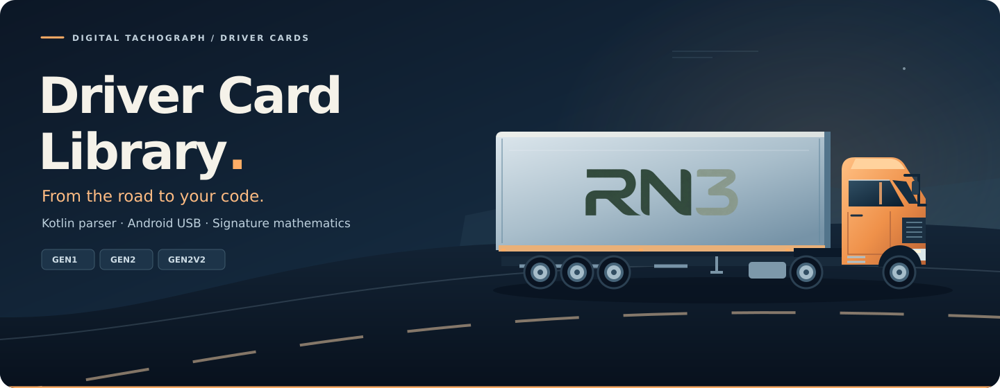
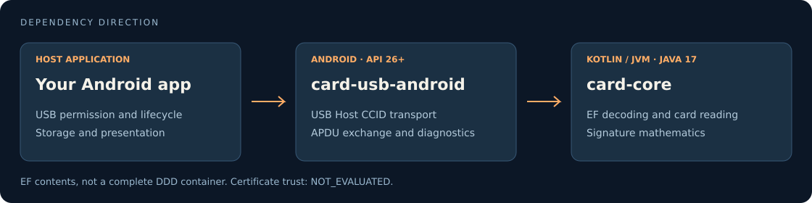

# Driver Card Library

**Driver Card Parser & Android USB Library**

Read digital tachograph driver cards, decode supported elementary files (EFs),
and verify captured signatures mathematically. A Kotlin/JVM core with a small
Android USB Host transport, usable independently of the original application.


> **Source availability:** open source on GitHub; technical version `0.1.0-SNAPSHOT`.
> No public package registry is configured. No original ERCA keys are bundled.
> Gen1 signature mathematics needs application-supplied public recovery keys;
> see [key provisioning](docs/KEY_MATERIAL.md).

## Features

- Typed parsers for implemented Gen1, Gen2 and Gen2V2 driver-card layouts.
- Application-aware reads with explicit optional-file failures and identity agreement.
- USB CCID/APDU communication through Android USB Host, with permission handled by your app.
- Original-byte capture and offline RSA/ECDSA signature mathematics for selected EFs.
- Synthetic fixtures, scripted transport tests and an independent Maven-only Android consumer.

No application UI, database, cloud service or driving/rest infringement engine is included.

## Supported Driver Card Generations

| Data family | Gen1 | Gen2 | Gen2V2 |
| --- | --- | --- | --- |
| Identification, activities and vehicles | Implemented | Implemented | Implemented |
| Controls, events, faults, conditions and work-period places | Implemented | Implemented | Implemented |
| GNSS accumulated driving / vehicle units used | — | Implemented | Implemented |
| GNSS/place authentication, borders, load/unload and load types | — | — | Implemented |
| Certificate framing | Gen1 | Gen2 | Gen2 |

Support means the fixed layouts implemented and exercised by the retained tests,
not every historical or proprietary variant. Gen2V2 is read through the Gen2
application; there is no third application AID. See [coverage](docs/COVERAGE.md)
for metadata, supported signature families and explicit exclusions.

## Module Overview



| Module | Responsibility | Platform |
| --- | --- | --- |
| `card-core` | Card reader, APDU/CCID protocols, EF parsers and signature mathematics | Kotlin/JVM, Java 17 |
| `card-usb-android` | USB Host CCID transport and optional reader diagnostics; exposes the core | Android API 26+ |

The public package remains `de.fahrerabrechnung.data.card` to preserve compatibility.
It has no dependency on the private FahrerTagebuch application.

## Installation

Install **JDK 17**, **Android SDK Platform 35** and **Build Tools 35.0.0**. Set
`ANDROID_HOME`, or use an untracked `local.properties` with `sdk.dir`.
Gradle 8.13, Kotlin 2.1.20 and AGP 8.9.1 are pinned by the project.

Build and publish both modules to your local Maven cache:

```sh
./gradlew :card-core:publishToMavenLocal :card-usb-android:publishToMavenLocal
```

Add `mavenLocal()` alongside `google()` and `mavenCentral()` in your consumer's
dependency repositories, then use:

```kotlin
dependencies {
    implementation("de.fahrertagebuch:card-core:0.1.0-SNAPSHOT")
    implementation("de.fahrertagebuch:card-usb-android:0.1.0-SNAPSHOT")
}
```

The USB module also exposes the core transitively. These are **local development
coordinates**, not a Maven Central or JitPack release. Retain POM and Gradle module
metadata; copying only an AAR loses transitive dependencies.

See [installation](docs/INSTALLATION.md) for source integration and
[the standalone consumer](examples/android-consumer/README.md) for a reproducible
integration through Maven coordinates only.

## Quick Start

After a successful card read, decode captured EF contents using the typed parsers:

```kotlin
import de.fahrerabrechnung.data.card.*

fun decode(result: CardReadResult) {
    val days = result.activity?.let(CardActivityParser::parse).orEmpty()
    val vehicles = result.vehicles?.let(CardVehiclesParser::parse).orEmpty()
    // Bind these results to your application's own immutable records.
}
```

Inputs are elementary-file contents and typed captures, **not arbitrary DDD
containers**. Check application status and each file's failure flags before using
results. A missing EF is different from an empty parsed file. See [the API guide](docs/API.md).

## Android USB Integration

Your app requests USB permission and owns the receiver, lifecycle, device selection
and cancellation. Once permission has been granted:

```kotlin
import android.content.Context
import de.fahrerabrechnung.data.card.*
import kotlinx.coroutines.Dispatchers
import kotlinx.coroutines.withContext

suspend fun readCard(context: Context): CardApplicationReadBatch =
    withContext(Dispatchers.IO) {
        DriverCardReader(AndroidCcidTransport(context)).readApplications()
    }
```

`readApplications()` probes Gen1 and Gen2 in one powered session and closes the
transport in `finally`. Inspect each attempt's `status` and `identityAgreement`;
do not silently merge different application identities.

The device must support USB Host/OTG and an **APDU-level CCID** reader. Readers
requiring host-side TPDU/character exchange are rejected. Compatibility with every
reader is not claimed. Follow the [permission integration guide](docs/API.md#permission-integration)
and consult [the consumer's compiled API example](examples/android-consumer/app/src/main/kotlin/example/consumer/LibraryUsage.kt).

## Signature Verification

Capturing a signature does not verify it. For a successful `CardReadResult`:

```kotlin
// Obtain and validate the public recovery entry in your own application.
val math = CardSignatureMath(recoveryKeys = listOf(applicationProvidedPublicKey))
val issuer = result.certificates[CardCertificateKind.CA]?.file
val verdicts = result.coreSignatures.mapValues { (_, receipt) ->
    math.verify(receipt, issuer)
}
```

Supported mathematics include Gen1 RSA-1024/SHA-1 and Gen2/V2 ECDSA on six fixed
domains, for the [implemented signed EF families](docs/COVERAGE.md#signature-mathematics).
Matching overloads accept identity and event/fault receipts.

**`VALID` means the signature mathematics matched the captured bytes. Certificate
trust is always `NOT_EVALUATED`.** No issuer-chain validation, revocation or expiry
policy is performed. `CardSignatureMath()` remains usable with an **empty** Gen1
recovery catalog. With complete Gen1 captures but no matching key, it returns
`NOT_CHECKABLE / UNKNOWN_GEN1_RECOVERY_KEY`, never `INVALID` for a missing key.
Gen2/Gen2V2 mathematics and all parsers/readers remain usable without Gen1 keys.
No keys are fetched automatically. See [official sources, the 144-byte format
and integration](docs/KEY_MATERIAL.md).

## Documentation

| Guide | Contents |
| --- | --- |
| [API](docs/API.md) | Entry points, permission handling, buffers and signature contracts |
| [Installation](docs/INSTALLATION.md) | Toolchain, source and Maven integration |
| [Coverage](docs/COVERAGE.md) | Supported layouts, generations and signature EFs |
| [Testing](docs/TESTING.md) | Commands, synthetic fixtures and test boundaries |
| [Android consumer](examples/android-consumer/README.md) | Independent Maven-only integration example |
| [License & attribution](docs/LICENSE_REVIEW.md) | Ownership statement, license scope and notice handling |
| [Third parties](docs/THIRD_PARTY.md) / [Key provisioning](docs/KEY_MATERIAL.md) | Dependency licenses and application-supplied public keys |
| [Source history & verification](docs/RELEASE_PREPARATION.md) | Clean source history and reproducible checkout checks |

## Testing

```sh
./gradlew :card-core:test :card-usb-android:testReleaseUnitTest \
  :card-usb-android:assembleRelease :card-usb-android:lintRelease
python3 tools/audit-release.py
```

For core-only checks without the Android SDK:

```sh
./gradlew -PcoreOnly :card-core:test :card-core:jar
```

The reference candidate had 447 core, 4 USB-module JVM and 5 external consumer
tests. Key-provisioning regressions add 8 core and 2 consumer tests; the workflow
expects **455 / 4 / 7 tests**, zero failures and zero skipped tests. Actual run
results are recorded by [GitHub Actions](https://github.com/Perrystack9/tachograph-driver-card-kotlin-clean/actions/workflows/verify.yml).
See [testing](docs/TESTING.md) for commands and scope.

Tests use synthetic card records only. No physical USB-reader test is implied.

## Known Limitations

- No complete DDD container import/export or universal format-compliance claim.
- No certified tachograph processing or trusted-certificate decision.
- Fixed implemented layouts and signature families; unsupported data may be rejected.
- No universal reader compatibility; no physical reader matrix was run for extraction.
- No infringement calculation, UI, storage, profile matching or reporting.
- Captured card bytes may contain sensitive data; the host app controls handling and retention.

Never commit real identities, plates, VINs, card numbers, locations, card dumps or credentials.

## License & Attribution

Project-owned code, documentation and original graphics are licensed under
[Apache License 2.0](LICENSE). Third-party components retain their own licenses.
No original ERCA keys are distributed; the integrating application handles the
source and applicable terms of any public keys it chooses to supply.

When redistributing, include the license and preserve the relevant copyright and
origin attribution in [NOTICE](NOTICE), as required by Apache-2.0 §4. A discreet
entry in accompanying third-party notices referring to [rn3.de](https://rn3.de)
is a suitable way to retain that origin credit. Modified files must be marked as
changed. No additional app-UI branding requirement is imposed.
See [attribution guidance](docs/LICENSE_REVIEW.md#redistribution-and-attribution).

## Project Home

[Source, documentation and examples on GitHub](https://github.com/Perrystack9/tachograph-driver-card-kotlin-clean).
